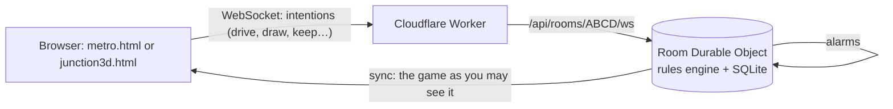

# Junction

Rail games for the browser, made for phones first. **Junction: Delhi Metro** is the lead game: drive a metro train across a
3D toy Delhi, take line passes in the real line colours, claim segments one tap at a time, and finish your destination
tickets. Play **online with up to 4 friends** (robots fill any empty seat) or solo against three robots. The older
**Junction 3D** walks a Sprocket robot across Europe.

**Play now: https://junction.aggarwalpulkit596.workers.dev** (Delhi Metro: `/metro.html`, Europe 3D: `/junction3d.html`)

Original names, maps and art. Delhi Metro station names and line colours are public facts; the schematic and the 3D city
are ours. No build step to *play*: each game is a single HTML file.

| Game | File | Online |
|---|---|---|
| **Junction: Delhi Metro** (the lead game) | `metro.html` (generated from `metro/`) | ✅ up to 4 players |
| Junction 3D: Europe | `junction3d.html` (generated) | ✅ up to 4 players |
| Junction 2D | `junction.html` | solo |
| Saboteur Express (2D) | `junction-saboteur.html` | solo |
| Saboteur Express 3D | `junction3d-saboteur.html` (generated) | solo |

## Delhi Metro in one minute

- **Each turn, one thing:** take 2 passes (face-up or from the deck), or **drive** one free segment that touches your network.
- A segment costs one pass of its line colour per car; **Smart Cards** are wild. Grey Line, Aqua Line and Rapid Metro take any one colour.
- A segment your network doesn't reach is a **depot run**: one extra pass of any kind.
- **Tickets** name two stations: +points if your network joins them, −points if not. Segments score 1 / 2 / 4 / 7 for 1–4 cars; longest line +10.
- **Signal failures** close a random free segment every third round; everyone has one **🚧 Jam** (close a free segment for 2 rounds).
- When someone is down to 2 trains, everyone gets one more turn.

| | Rush Hour | Full Line |
|---|---|---|
| Length | **5 to 10 minutes** | **about 15 minutes** |
| Trains each | 16 | 24 |
| Turn timer (online) | 25 s | 40 s |
| Game clock (online) | 10 min, then one final round | 25 min, then one final round |
| Starting tickets | 3 short, keep ≥ 1 | 1 long + 3 short, keep ≥ 2 |

`mp/metro-sim.mjs` plays hundreds of games on a virtual clock: Rush Hour runs ~16 rounds, about 4 minutes with robots and
~9.6 with four people; Full Line ~24 rounds, about 14 minutes with four people. No stalls, no refused robot actions.

## Europe 3D: two game lengths

| | Blitz | Classic |
|---|---|---|
| Length | **5 to 10 minutes** | **about 30 minutes** |
| Trains each | 18 | 40 (fills the map) |
| Turn timer (online) | 25 s | 45 s |
| Game clock (online) | 8 min, then one final round | 28 min, then one final round |
| Starting tickets | 3 short, keep ≥ 1 | 1 long + 3 short, keep ≥ 2 |

## How online play works



- **The server owns the game.** The deck, every hand and every ticket stay on the server. Each player gets a view with
  only their own cards, rotated so they are always player 0 (the 3D client's "You").
- **One rules engine per game.** Delhi Metro's `metro/rules.js` runs unchanged in the Worker and (inlined) in the
  browser for solo play. For Europe, `mp/build.mjs` slices payment, bot routing and scoring out of `junction.html` into
  the server engine. Fix a rule once and every version gets it. A room belongs to one game; the Room picks the engine.
- **Robots are never in the way.** They fill empty seats, walk to their target before acting (paced by Durable Object
  alarms), and take over a human's turn when the timer runs out or the player disconnects. Reload the page and you get
  your seat back. A friend who joins mid-game takes over a robot.
- **Hosting** is one Worker that serves the static site in `public/` and the `/api/*` endpoints. It runs on the
  Workers Free plan (SQLite-backed Durable Objects).

Protocol and internals: [`docs/ONLINE.md`](docs/ONLINE.md).

## Run it locally

```bash
npm install                 # wrangler + puppeteer-core (tests use your installed Google Chrome)
npm run dev                 # builds everything, then serves http://localhost:8787 with the multiplayer server
npm run dev:fast            # same, with robots that move ~6x faster (handy for testing)
```

Open `http://localhost:8787/metro.html` (or `junction3d.html`) in two browser windows (or a normal and a private one),
create a room in one and join with the code in the other.

## Deploy to Cloudflare

```bash
npx wrangler login          # once: opens the browser to authorise your Cloudflare account
npm run deploy              # builds and deploys to https://junction.<your-subdomain>.workers.dev
```

To deploy automatically from GitHub on every push to `main`, add two repository secrets: `CLOUDFLARE_API_TOKEN`
(a token from the "Edit Cloudflare Workers" template) and `CLOUDFLARE_ACCOUNT_ID`. See `.github/workflows/deploy.yml`.

## Checks

```bash
npm run build               # rebuild metro.html, the 3D pages, the server engine and public/
npm run sim                 # both engines: balance for every length + no-stall checks (Node only, a few seconds)
node tools3d/sim.mjs 100 18 # solo 3D game in headless Chrome (needs puppeteer-core)
npm run dev:fast            # then, in another terminal:
npm run test:online         # real browsers, both games: create, join, reload, mid-game join, a whole game, rematch
```

## Project layout

```
metro/                        Delhi Metro: rules.js (the engine) + metro.template.html (the 3D client) → metro.html
junction.html                 2D Europe game, and the source of the shared Europe rules
junction-saboteur.html        2D Saboteur Express
tools3d/                      3D template + build scripts (junction3d*.html are generated from here)
mp/                           online: Europe engine template, build, sims, end-to-end tests (both games)
worker/                       Cloudflare Worker + Room Durable Object (rules.gen.js is generated)
site/                         landing page, favicon, headers
public/                       built site that Cloudflare serves (generated, not committed)
promo/, promo-saboteur/       trailer pipelines (big media is not committed)
video/                        gameplay teaser recorder
docs/                         ONLINE.md (how multiplayer works), ITERATIONS.md (what changed, and why)
```

## History

Every change is a numbered iteration: see [`docs/ITERATIONS.md`](docs/ITERATIONS.md) for the story and
[`CHANGELOG.md`](CHANGELOG.md) for the short version. `git log` has one commit per iteration.
